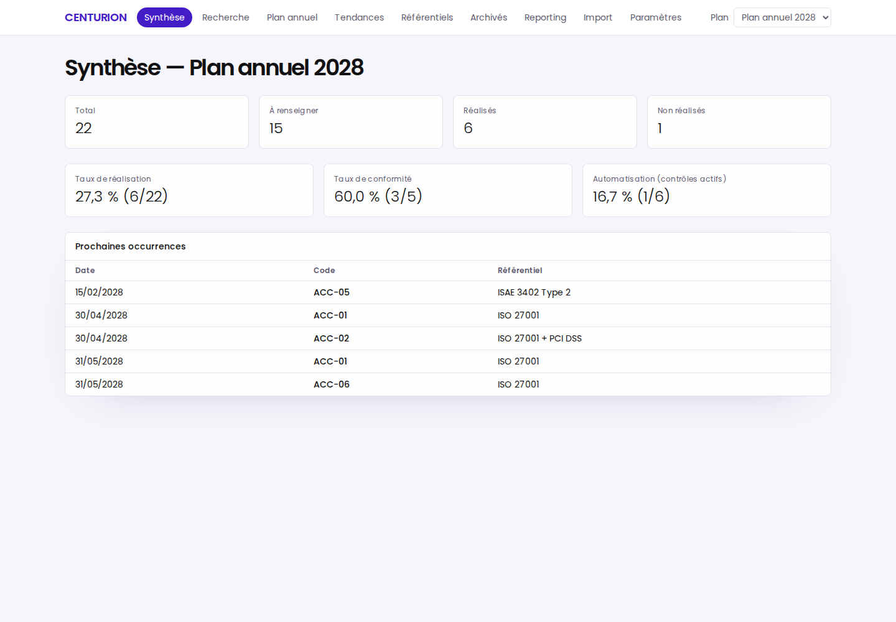

# CENTURION — suivi local et open source d'un plan annuel de contrôles

**C**ontrôles, **É**chéances, **N**ormes, **T**raçabilité : **U**n **R**egistre **I**ndépendant, **O**uvert, **N**atif

**Contexte :** projet personnel open source, distinct des outils internes réalisés en contexte professionnel (Watchtower, La Sentinelle).  
**Rôle :** conception, développement et mise en production (v1.0.0) de l'application complète.

## Problème

Suivre un plan annuel de contrôles cyber/IT suppose de relier chaque contrôle à ses occurrences, ses réalisations auditées, ses justificatifs et ses tendances d'une année sur l'autre — sans envoyer ses données sur un SaaS externe.

## Contribution

J'ai construit une application local-first et mono-utilisateur (Node.js 24, Fastify, SQLite, React/Vite) qui fait ce suivi : plan annuel, occurrences récurrentes, réalisations auditées avec historique, justificatifs bornés (≤ 5 MiB, typés), recherche globale, tendances multi-années, mapping de clauses, archivage. J'y ai ajouté des exports bornés (CSV/PDF), des sauvegardes cohérentes avec restauration journalisée, et un serveur MCP stdio en lecture seule par défaut (10 outils) dont les écritures passent par des propositions approuvées dans l'UI — utilisable depuis OpenCode, Codex, VS Code, Claude Desktop, etc. Le dépôt inclut une notice d'utilisation illustrée (Markdown + page HTML autonome) avec captures réelles.

Le dépôt sert de référence d'implémentation : si le besoin est proche, on peut reprendre le code et l'adapter.

**Technologies :** TypeScript, Fastify, better-sqlite3, React, Vite, Tailwind v4, shadcn/ui, Playwright, MCP SDK, zod.

## Résultat et limites

L'application est testée de bout en bout : 177 tests unitaires/intégration/sécurité/MCP (`npm run check`) et 9 scénarios Playwright (`npm run test:e2e`). La CI GitHub Actions tourne sur Ubuntu avec trois jobs : `check`, `e2e` et `docker` — ce dernier construit l'image, la démarre durcie et la scanne avec Trivy (sévérité CRITICAL). Le self-hosting se fait sur Linux via une image Docker durcie : distroless, utilisateur non-root (UID 65532), système de fichiers racine en lecture seule, `cap_drop: ALL`, port publié uniquement sur 127.0.0.1. Limites assumées : mono-utilisateur sans SSO, écoute sur 127.0.0.1 uniquement, aucun chiffrement applicatif, justificatifs non scannés par antivirus. Les exemples ISO 27001 / ISAE 3402 illustrent le suivi ; ils ne constituent ni une évaluation de conformité ni une opinion d'assurance.

[Dépôt GitHub — github.com/msafla/centurion](https://github.com/msafla/centurion) · [Notice illustrée dans le dépôt](https://github.com/msafla/centurion/blob/main/docs/NOTICE.md)
