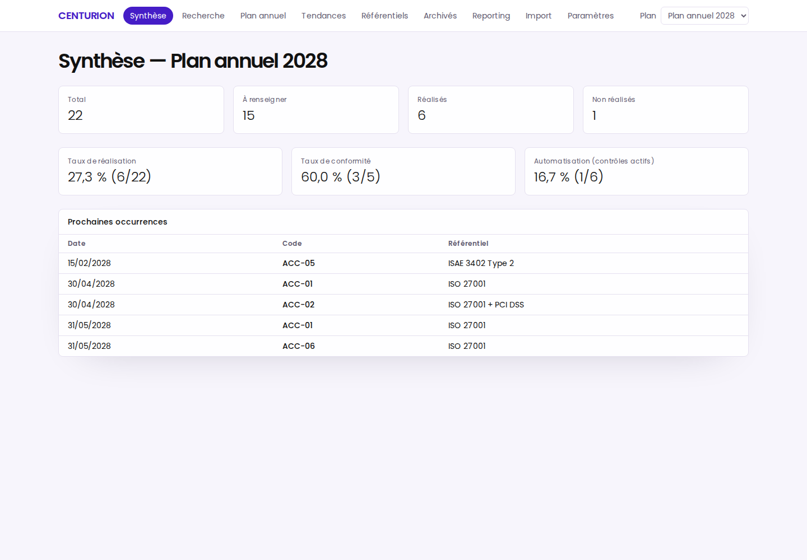

# CENTURION — suivi local et open source d'un plan annuel de contrôles

**Contexte :** projet personnel open source, distinct des outils internes réalisés en contexte professionnel (Watchtower, La Sentinelle).  
**Rôle :** conception, développement et mise en production (v1.0.0) de l'application complète.

## Problème

Suivre un plan annuel de contrôles cyber/IT suppose de relier chaque contrôle à ses occurrences, ses réalisations auditées, ses justificatifs et ses tendances d'une année sur l'autre — sans envoyer ses données sur un SaaS externe.

## Contribution

- Application **local-first et mono-utilisateur** (Node.js 24, Fastify, SQLite, React/Vite) : plan annuel, occurrences récurrentes, réalisations auditées avec historique, justificatifs bornés (≤ 5 MiB, typés), recherche globale, tendances multi-années, mapping de clauses, archivage.
- Exports bornés (CSV/PDF) et sauvegardes cohérentes avec restauration journalisée.
- Serveur **MCP stdio** en lecture seule par défaut (10 outils), écritures proposées puis approuvées dans l'UI — utilisable depuis OpenCode, Codex, VS Code, Claude Desktop, etc.
- Notice d'utilisation illustrée (Markdown + page HTML autonome) avec captures réelles.

**Technologies :** TypeScript, Fastify, better-sqlite3, React, Vite, Tailwind v4, shadcn/ui, Playwright, MCP SDK, zod.

## Résultat et limites

L'application est testée de bout en bout (170 tests unitaires/intégration/sécurité/MCP + 9 scénarios Playwright) avec une CI GitHub Actions (check sur Ubuntu/Windows, e2e sur Ubuntu). Limites assumées : mono-utilisateur sans SSO, écoute sur 127.0.0.1 uniquement, aucun chiffrement applicatif, justificatifs non scannés par antivirus. Les exemples ISO 27001 / ISAE 3402 illustrent le suivi ; ils ne constituent ni une évaluation de conformité ni une opinion d'assurance.

[Dépôt GitHub — github.com/msafla/centurion](https://github.com/msafla/centurion) · [Notice illustrée dans le dépôt](https://github.com/msafla/centurion/blob/main/docs/NOTICE.md)
